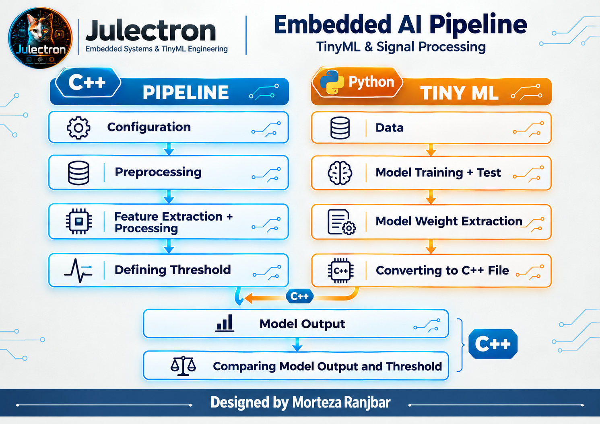
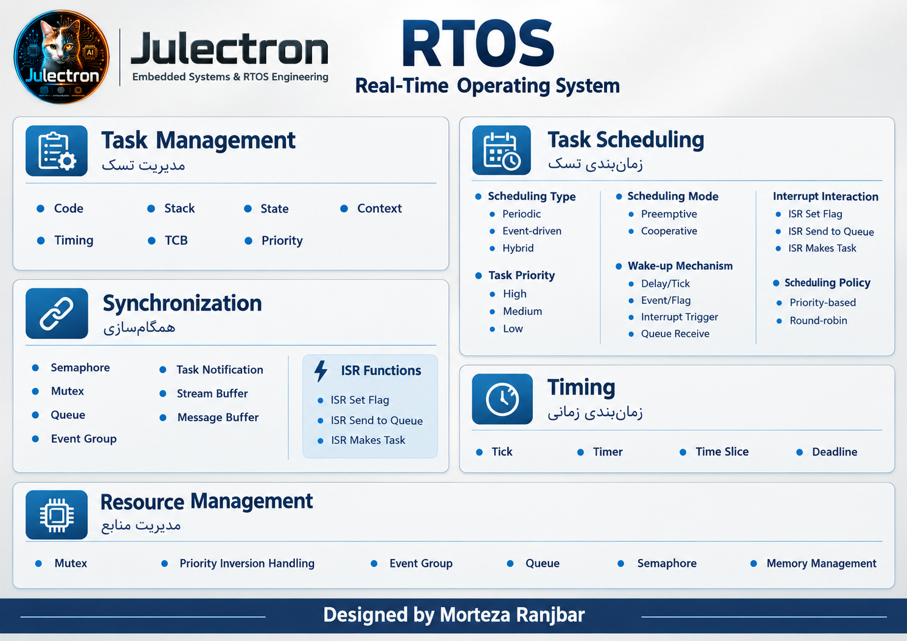

# Embedded AI Pipeline on STM32

## Overview
This project is a complete, hands-on implementation of an **Edge AI pipeline** for embedded signal processing and TinyML. It demonstrates how a full pipeline works — from peripheral configuration to deploying model weights on the device.

The full pipeline covers:
- Configuring and enabling the relevant peripherals (ADC as the sampler, DMA, TIM2)
- Defining signal buffers
- Applying filters (low-pass) and Normalization
- Applying a Hann window for feature extraction
- Setting detection thresholds
- Training a logistic regression model in Python
- Extracting weights and exporting them as a C file
- Embedding the weights into the on-device model for real-time inference

## Project Status
- **Software Level:** Fully implemented and verified in terms of logic and architecture.
- **Hardware Level:** *Not yet deployed on physical hardware.* The code is currently a robust reference implementation, ready for hardware-in-the-loop (HIL) testing and STM32CubeMX integration. Feedback and corrections are always welcome.

## Roadmap Diagrams
I have also designed two roadmap diagrams. These are intentionally **simplified** (without low-level path details) so that beginners don't get overwhelmed.

**1. Embedded Systems Pipeline**

**2. RTOS Roadmap (Overview)**

## About the Author
I am Morteza Ranjbar, an **Embedded Systems & AI Designer**, an **Electronics Circuit Designer (from scratch)**, and the founder of **Julectron**. I specialize in designing Real-Time architectures, developing custom hardware circuits, and deploying AI models on edge devices. This project is part of my journey to build Julectron.

## Connect with Me
If you find this useful, follow my work:
- 🌐 GitHub: [Julectron](https://github.com/Julectron)
- 📸 Instagram: [@Julectron](https://instagram.com/Julectron)
- ▶️ YouTube: [Julectron](https://youtube.com/@Julectron)

---
**Author:** Morteza Ranjbar (Founder of Julectron)  
**License:** MIT (Attribution required)
---
---
## 📚 Further Reading

If you want to explore **my mental model** and dive deeper into the system architecture and data management concepts, explore the following documents:

- 🏗️ **[Architecture Deep Dive (Roadmap)](docs/embedded-ai-roadmap.md)** - Detailed breakdown of the C++ pipeline stages.
- 💾 **[Data Management Concepts (Part 1)](docs/data-management-part1.md)** - Core concepts like Data Path, Flow, and Integrity.
- ⚙️ **[Peripheral Roles in Data Flow (Part 2)](docs/data-management-part2.md)** - Understanding the three roles of peripherals.
